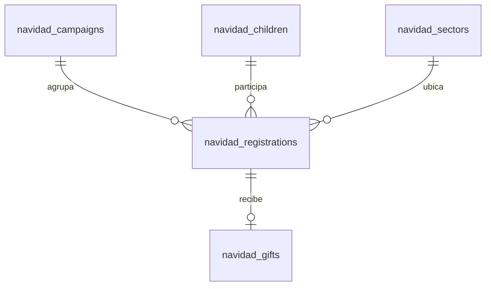

# Sistema de Navidad de La Florida

Aplicación municipal para administrar inscripciones, asignaciones y entregas de regalos navideños. React, TypeScript, Tailwind CSS v4, componentes shadcn/ui sobre Radix, Recharts, Supabase y exportación ExcelJS.

La aplicación se puede publicar en **Netlify**, con una dirección .netlify.app o un dominio propio. Una vez desplegada funciona sin ChatGPT ni sus plugins. GitHub almacena el código, Netlify sirve la web y Supabase mantiene los usuarios y datos.

## Estado

- Supabase conectado y activo. Esquema y datos ficticios de las campañas 2025 y 2026 aplicados.
- Inicio de sesión confirmado por el usuario. Acceso por correo y contraseña y opción de Google.
- Resumen y consultas paginadas optimizados en PostgreSQL, con RLS.
- Configuración de Netlify y CI preparada. **Repositorio remoto y despliegue aún pendientes de acceso y verificación.**
- ExcelJS está declarado, pero su instalación y la compilación completa siguen pendientes por las restricciones del entorno. No se considera validada la descarga Excel todavía.

## Ejecución local

Requiere Node.js 24 y npm.

```powershell
npm.cmd install
npm.cmd run dev
```

En otros sistemas usar npm en lugar de npm.cmd. La primera instalación debe actualizar package-lock.json con las dependencias nuevas; no usar npm ci hasta sincronizar el lockfile. Las contraseñas y claves secretas no se guardan en el repositorio.

```powershell
npm.cmd run build
npm.cmd run preview
```

El servidor local no necesita permanecer encendido después de publicar el sitio.

## Funciones

| Pantalla | Funciones |
| --- | --- |
| Resumen | Indicadores, mapa, barras apiladas, entregas semanales y tabla ordenable por pendientes. |
| Inscripciones | Búsqueda, filtros, paginación y registro de niños por campaña. |
| Asignación | Un regalo por niño inscrito en cada campaña. |
| Entregas | Fecha y receptor; una entrega no puede registrarse dos veces. |

Los filtros de campaña y sector se comparten entre vistas, mapa, gráficos y exportación. Quedan reflejados en la URL. El mapa aplica el sector al resto del sistema. En móvil los filtros permanecen accesibles y las tablas admiten desplazamiento horizontal.

Inscritos cuenta niños únicos por campaña. Pendientes es asignados menos entregados, sin incluir a quienes todavía no tienen regalo asignado. Avance es entregados / asignados; si no hay asignaciones es cero.

Los datos, sectores, límites y marca gráfica son ilustrativos. No representan registros ni divisiones oficiales. El corte inicial ficticio es el 20 de diciembre de cada campaña.

## Configuración pública

La aplicación no depende de archivos dotenv ni de variables de compilación para conectarse. La configuración está en [src/config/public.ts](src/config/public.ts) y contiene exclusivamente:

- mode: supabase para el sistema conectado o demo para pruebas locales deliberadas.
- supabaseUrl: la dirección HTTPS del proyecto.
- supabasePublishableKey: clave pública del navegador, formato sb_publishable_.
- googleMapsApiKey: opcional; sin ella se mantiene el mapa ilustrativo.

La URL y la clave pública son visibles en cualquier aplicación web que usa Supabase. No son contraseñas ni conceden acceso administrativo. La protección de los datos se aplica en Supabase Auth, RLS, los perfiles del equipo y los permisos de tablas y funciones. No colocar aquí claves secretas, service_role, contraseñas ni tokens personales.

El modo conectado exige una URL HTTPS y una clave pública válida. Ante un error no se cambia silenciosamente a la demo. Si se modifica la configuración, se debe reconstruir y volver a desplegar el sitio. Netlify no necesita recibir claves privadas para servir esta aplicación.

## Base de datos y consultas

El modelo separa campañas, sectores, niños, inscripciones, regalos y personal autorizado. La inscripción tiene una clave única compuesta por campaña y niño; la asignación referencia esa inscripción y su sector.



- navidad_sector_summary: vista con security_invoker para agrupar por campaña y sector.
- navidad_dashboard(): una consulta devuelve los indicadores y series agregadas de las campañas. No descarga registros personales para calcular gráficos.
- navidad_records_page(...): búsqueda y filtros en el servidor, con páginas de 15 registros, orden estable y un límite máximo de 100. Los detalles personales se unen después de seleccionar los identificadores de la página.
- navidad_assign_gift(...): resuelve el sector en el servidor y asigna el regalo de forma atómica.
- navidad_register_child(...) y navidad_deliver_gift(...): inscripción transaccional y entrega condicionada a que siga pendiente.

Se añadió un índice por campaña, sector y niño para las listas filtradas. Se conserva la separación actual de entidades. No se introdujeron particiones ni duplicaciones de datos sin una necesidad medida.

La carga anterior recorría 44.092 inscripciones y regalos en unas 45 solicitudes de datos. El nuevo resumen usa una RPC y devolvió **5.861 bytes** en la comprobación remota; la medición de ejecución fue **42,386 ms** en ese momento. Son mediciones del conjunto de prueba, no una garantía de tiempos en cualquier carga.

Los perfiles viewer leen; operator y admin pueden inscribir, asignar y entregar. Las funciones usan SECURITY INVOKER y las tablas y la vista respetan RLS. El navegador no puede agregar personal ni cambiar roles.

Para un proyecto nuevo, revisar y aplicar los archivos en este orden: supabase/schemas/001_navidad.sql, supabase/schemas/002_queries.sql y supabase/seed.sql. No volver a ejecutarlos sin comparar contra un proyecto ya configurado. El seed es aditivo e idempotente. Ver [documentación de Supabase](supabase/README.md) y [verificación remota](supabase/verification.md).

## Acceso y contraseñas

Una cuenta creada originalmente con Google necesita configurar una contraseña antes de utilizar el acceso por correo. También puede usar Continuar con Google. Después de entrar, el botón de llave de la cabecera permite configurar una contraseña mediante Supabase Auth. El repositorio no contiene contraseñas de usuarios.

Para un nuevo funcionario: invitar su cuenta desde Supabase Auth e incorporar su UUID en navidad_staff desde una sesión administrativa. Nunca agregar ese mecanismo administrativo al cliente público.

## Excel

Descargar Excel respeta los filtros y genera un archivo .xlsx con Resumen y Entregas semanales. Conserva números y fechas como valores tipados; incluye filtros, totales, fórmulas de pendientes y avance, valores calculados en caché y formato municipal. La biblioteca se carga al solicitar la descarga. Si falla, se muestra un error y se puede reintentar.

## Pruebas

```powershell
npm.cmd run test:data
npm.cmd test
npx.cmd playwright install chromium
npm.cmd run test:e2e
```

En Windows se puede usar Edge instalado:

```powershell
$env:PLAYWRIGHT_CHANNEL = 'msedge'
npm.cmd run test:e2e
```

Los tests de navegador usan sesiones y un backend RPC ficticios y aislados. No modifican las cuentas ni los datos remotos. GitHub Actions ejecuta comprobaciones, compilación y pruebas al subir cambios.

Se comprobaron 109 reglas de datos y flujo, 14 pruebas unitarias de datos, operaciones, errores y reportes, y las pruebas SQL de totales, semanas, filtros, paginación y acceso. Después de eliminar la configuración dotenv, pasaron 22 pruebas de navegador en escritorio y móvil, incluidas sesión simulada, filtros, paginación, inscripción, asignación y entrega. Estas pruebas no incluyen la exportación Excel pendiente ni certifican el acceso real a Google OAuth desde el alojamiento final.

La descarga y la prueba de lectura de vuelta de Excel siguen pendientes de instalar ExcelJS. La red del entorno bloqueó npm con EACCES. El lockfile debe actualizarse con una instalación completa. Ver [pasos de publicación](docs/DEPLOYMENT.md).

## Publicar sin chatgpt.site

Usar la integración GitHub para crear o seleccionar el repositorio y, en Netlify, importar ese repositorio. netlify.toml define Node.js 24, npm run build, salida dist, rutas SPA y cabeceras de caché. La configuración pública ya acompaña al código; Netlify no requiere cargar configuración de conexión separada.

El enlace .netlify.app estará disponible después de que el despliegue termine correctamente. Para Google OAuth, registrar la dirección final en las URL permitidas de Supabase. Un dominio propio requiere configurar DNS y esperar la activación HTTPS. El enlace definitivo y el repositorio se documentarán cuando existan y hayan sido verificados.

Guía completa: [GitHub y Netlify](docs/DEPLOYMENT.md).
